# Kariah & Khairat Masjid

Plugin WordPress untuk mengurus **Ahli Kariah (No. Kariah), Badan Khairat Kematian dan Ibadah Korban/Aqiqah** masjid atau surau — pendaftaran dalam talian, rekod manual oleh AJK, bayaran sekaligus atau ansuran, Portal Ahli dan papan pemuka infografik.

*A WordPress plugin for Malaysian mosques to run parish (kariah) registration with system-issued member numbers, death-benefit (khairat) membership for registered kariah members and qurban/aqiqah registration: online forms with payment-proof upload, instalment plans, AJK approval workflow, member self-service portal, CSV import/export and an infographic dashboard. UI is in Bahasa Melayu; IC-number (MyKad) aware.*

| Langkah 1 — Daftar Ahli Kariah | Langkah 2 — Daftar Khairat (Ahli Kariah sahaja) |
|---|---|
| 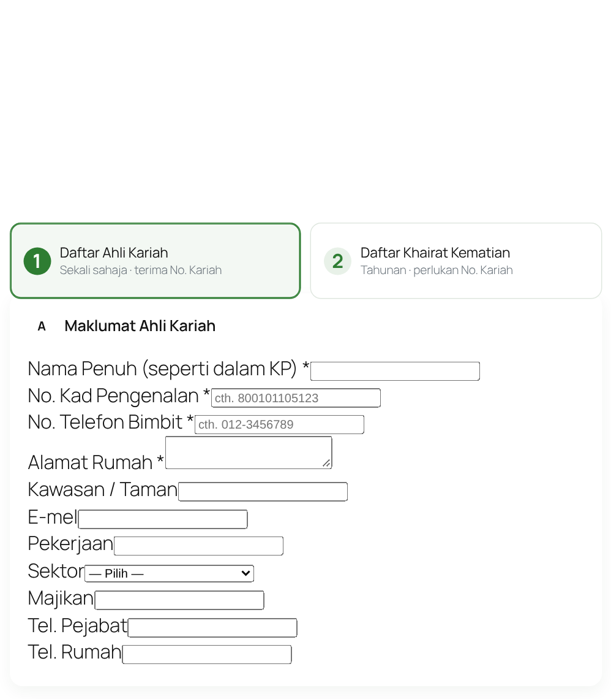 | 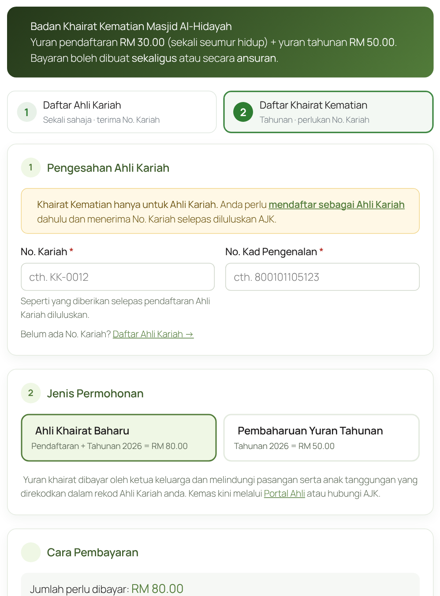 |

## Ciri-ciri

**Untuk orang awam**
- Borang **Daftar Ahli Kariah** (sekali sahaja, terima No. Kariah) dengan muat naik **salinan IC** / surat pengesahan alamat, semakan umur minimum dari No. KP dan **Daftar Khairat** untuk Ahli Kariah sahaja (ahli baharu / pembaharuan / tunggakan) dan **Daftar Korban & Aqiqah** (peserta, bahagian, agihan daging, akad wakalah)
- Bayaran **sekaligus atau ansuran** (2–36 bulan), muat naik bukti bayaran (JPG/PNG/PDF), kod QR & akaun bank masjid
- **Semak Status & Bayar Ansuran** dengan No. KP + No. Telefon
- **Kad Ahli Kariah** — dijana automatik (85.6 × 54 mm, 300 dpi) dengan gambar profil, No. Kariah, No. KP bertopeng dan kod pengesahan; muat turun atau cetak saiz sebenar dari Portal Ahli
- **Portal Ahli** — log masuk dengan No. KP; lihat yuran, resit rasmi, tanggungan; kemas kini maklumat hubungan terus, perubahan pasangan/tanggungan melalui kelulusan AJK

**Untuk AJK (wp-admin)**
- Papan pemuka dengan infografik (pendaftaran, kutipan, umur, kawasan, sektor, isi rumah)
- **Widget di Papan Pemuka WordPress** (1.5.2): *Ahli Kariah* (ahli aktif, jiwa dilindungi, ahli baharu, guna portal, status keahlian, kawasan teratas) dan *Khairat & Bayaran* (peratus yuran tahun semasa dijelaskan, kutipan, baki tertunggak, bayaran perlu disemak, bahagian korban) — setiap angka dipautkan ke senarai yang ditapis
- Senarai ahli dengan tapisan, kelulusan pukal, borang A4 boleh cetak, jana yuran tahunan
- Sahkan / tolak bayaran, muat naik resit rasmi, pelan ansuran per rekod
- Senarai peserta korban (7 bahagian seekor) boleh cetak
- Import dari Google Form / CSV (dengan larian percubaan), eksport CSV
- Peranan **AJK Kariah** (akses menu ini sahaja) dan **Ahli Kariah** (portal sahaja)
- Pengasingan tugas: AJK tidak boleh mengesahkan bayaran atau perubahan rekod sendiri
- Log audit setiap perubahan rekod ahli

**Keselamatan**
- Bukti bayaran disimpan di luar Media Library (`uploads/pk-private/`) dan hanya dihantar melalui pautan bernonce selepas semakan pemilikan
- Semakan kandungan fail (bukan sekadar sambungan nama), had cubaan per IP, honeypot & masa minimum isi borang
- Mesej status melalui token pelayan (tiada teks dari URL), perlindungan formula CSV, No. KP tidak pernah muncul dalam URL
- Amaran automatik jika folder bukti boleh diakses umum (cth. nginx yang tidak membaca `.htaccess`)

| Papan pemuka | Portal Ahli |
|---|---|
| 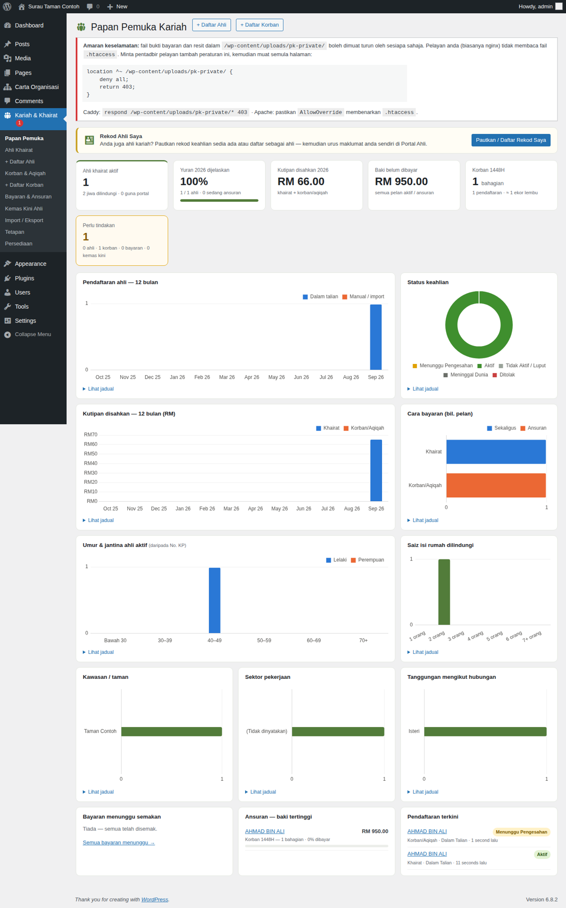 | 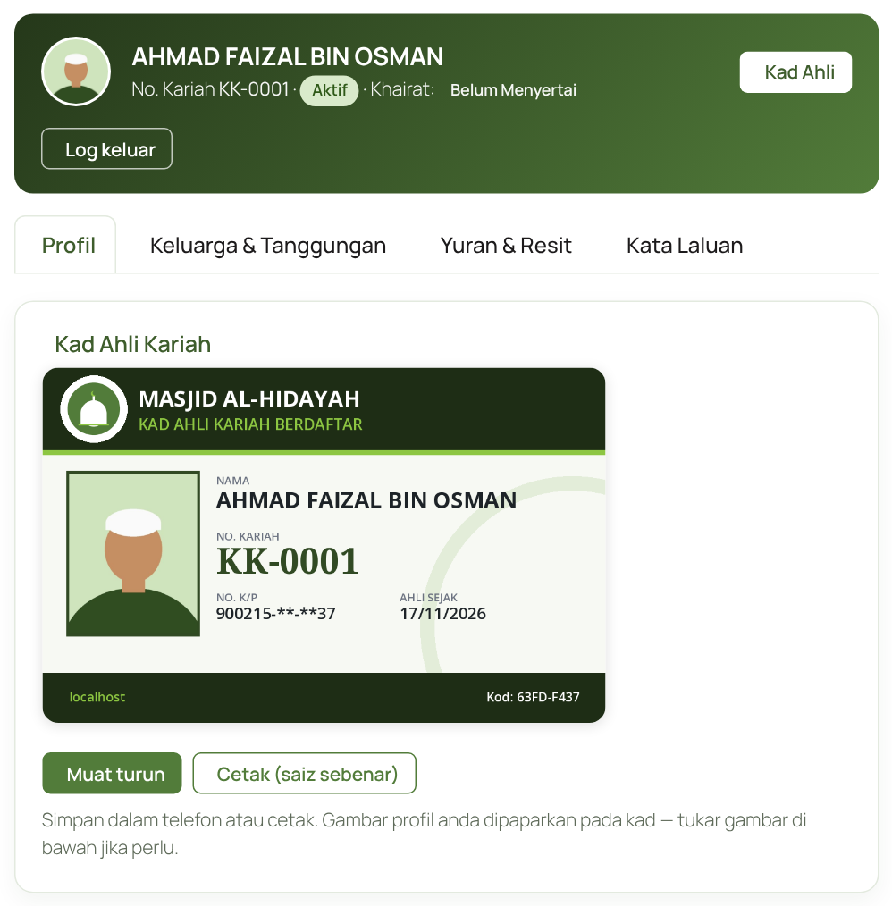 |

**Baharu dalam 1.7.0 — Dokumen sokongan, Kad Ahli Kariah & terma boleh disunting**
- **Dokumen sokongan:** borang Ahli Kariah mewajibkan salinan Kad Pengenalan; surat pengesahan alamat (JPKK / penghulu / pengerusi taman) diwajibkan jika alamat IC berbeza. Disimpan secara peribadi; AJK boleh lihat / muat naik dari rekod ahli, ahli boleh kemas kini di Portal Ahli. Senarai ahli menandakan rekod *Tiada salinan IC*.
- **Kad Ahli Kariah:** imej PNG dijana ketika diminta (tidak disimpan) untuk Ahli Kariah aktif — logo masjid, warna tema plugin, gambar profil, No. Kariah, No. KP bertopeng, tarikh ahli dan **kod pengesahan** (AJK semak kod pada rekod ahli). Butang *Kad Ahli* di Portal, halaman cetak saiz sebenar.
- **Terma Ahli Kariah** boleh disunting di Tetapan (`{masjid}` `{yuran_kariah}` `{umur_min_kariah}`), **umur minimum** pendaftaran (lalai 18 — disemak dari No. KP) dan pautan pilihan ke **halaman syarat & faedah**.

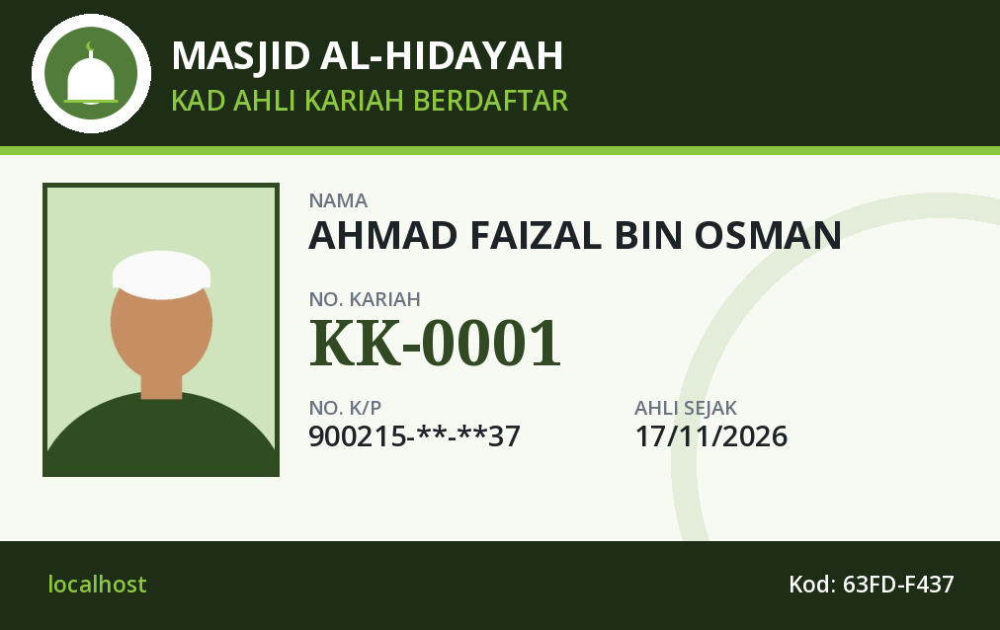

| Dokumen sokongan pada borang | Portal Ahli — kad & dokumen | Rekod ahli (AJK) |
|---|---|---|
| 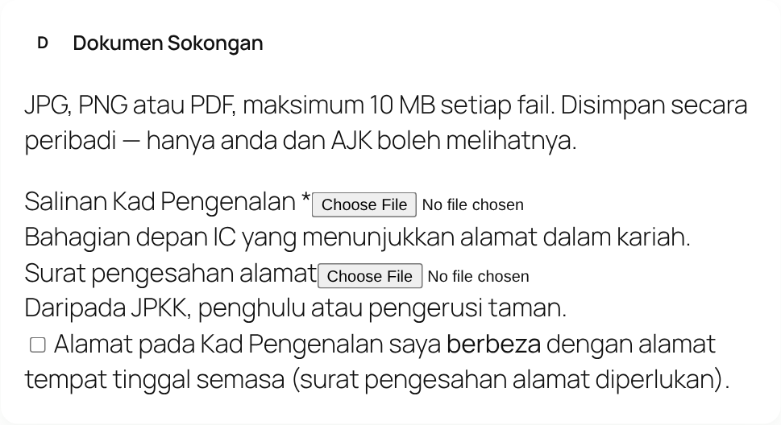 |  | 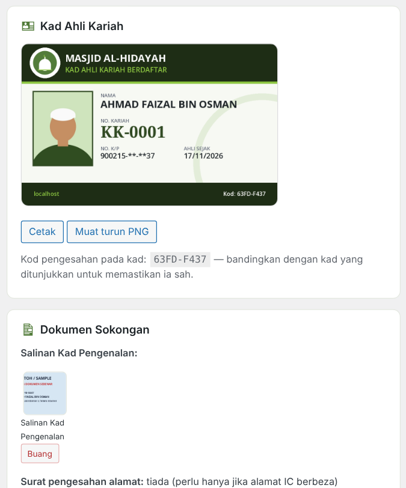 |

*Tangkapan skrin daripada laman ujian "Masjid Al-Hidayah" — nama, No. KP dan dokumen adalah contoh rekaan.*

**Baharu dalam 1.6.0 — Ahli Kariah dahulu, kemudian Khairat**
- Pendaftaran **Ahli Kariah** (sekali seumur hidup) kini langkah pertama. **No. Kariah** (`KK-0001`) diberikan **oleh sistem sahaja** — selepas AJK meluluskan pendaftaran **dan** yuran Ahli Kariah disahkan (atau yuran RM0 / dikecualikan). Tiada sesiapa boleh mengisi atau menukar No. Kariah secara manual.
- **Khairat Kematian hanya untuk Ahli Kariah aktif** — borang khairat meminta No. Kariah + No. KP (atau guna rekod Portal Ahli).
- Status baharu *Diluluskan — Menunggu Bayaran*; tetapan **Yuran Ahli Kariah** dan **had umur anak** tanggungan khairat (lalai 18 — anak lebih tua perlu daftar sendiri).
- Papan pemuka & senarai memaparkan status Ahli Kariah dan status Khairat secara berasingan.

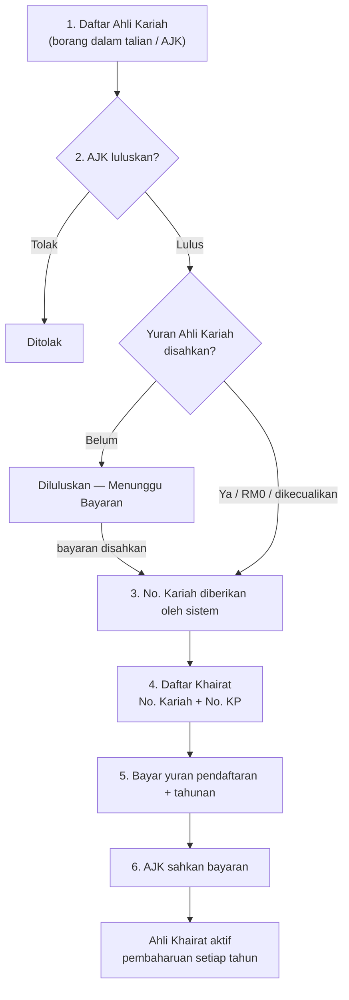

**Baharu dalam 1.5.0**
- **Makluman Takziah** — AJK isi nama, tarikh dan gambar (atau guna gambar profil ahli); plugin menjana **poster takziah 1500×2250** (gambar hitam putih dalam bingkai, doa, kaki imej) dan memaparkannya di laman utama dengan butang *Muat turun* dan *Kongsi WhatsApp* sehingga tarikh yang ditetapkan. Shortcode `[pk_takziah]`.
- **Gambar profil ahli** — ahli muat naik di Portal Ahli (dimampatkan, EXIF/GPS dibuang, disimpan secara peribadi); AJK boleh urus dari rekod ahli.
- **Portal Ahli untuk pelawat** — langkah bernombor *1 Daftar → 2 Aktifkan akaun → 3 Log masuk*.

| Poster takziah | Di laman utama | Portal Ahli (pelawat) |
|---|---|---|
| 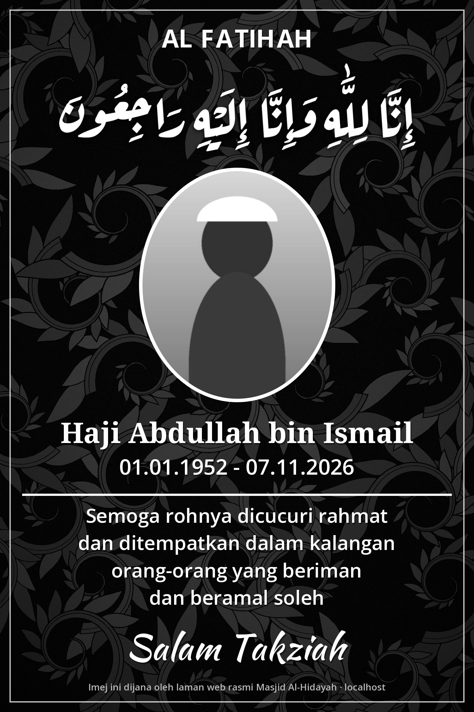 | 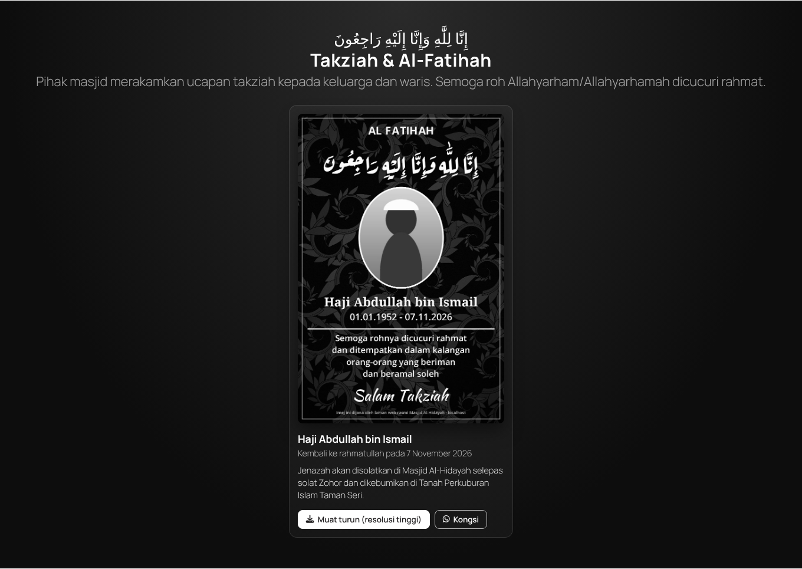 | 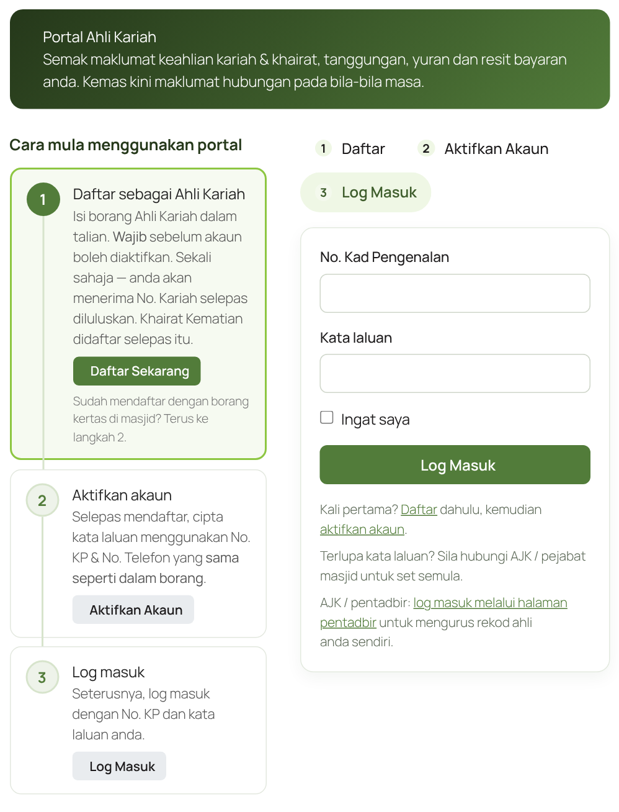 |

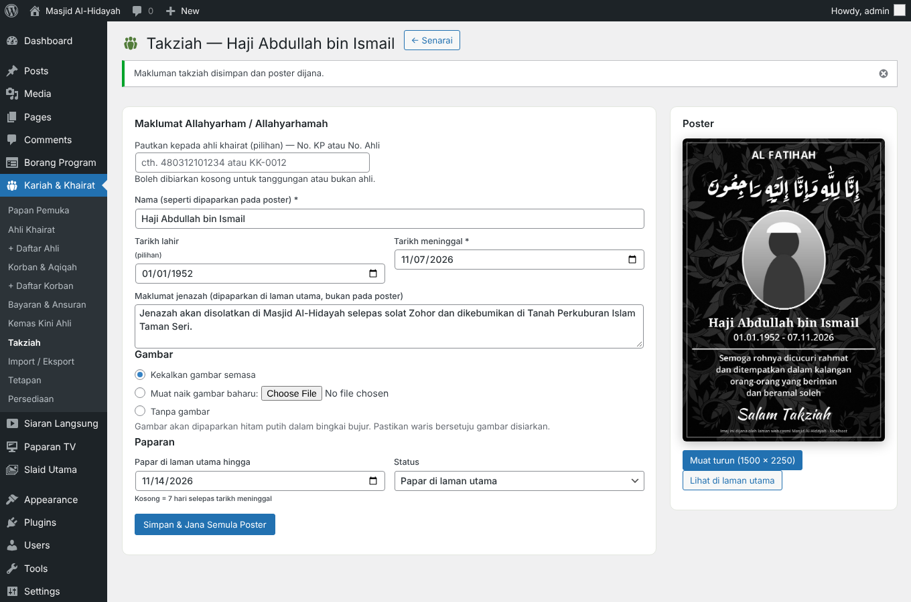

## Pemasangan

1. Muat turun **`kariah-khairat.zip`** dari halaman [Releases](../../releases/latest).
2. wp-admin → **Plugins → Add New → Upload Plugin** → pilih zip → **Install Now** → **Activate**.
3. Ikut **Kariah & Khairat → Persediaan**:
   - **Tetapan** — nama & alamat masjid, yuran Ahli Kariah & khairat, had umur anak, harga bahagian korban, akaun bank, imej QR, kawasan, terma & syarat, warna
   - **Cipta halaman** — enam halaman dicipta automatik dengan shortcode yang betul
   - Tambah halaman ke menu (Penampilan → Menu / Editor Tapak)
4. Cipta akaun AJK dengan peranan **AJK Kariah**.

Kemas kini seterusnya akan muncul di **Dashboard → Updates** seperti plugin biasa.

### Shortcode

| Shortcode | Fungsi |
|---|---|
| `[pk_borang_kariah]` | Borang pendaftaran Ahli Kariah (langkah 1) |
| `[pk_borang_khairat]` | Borang pendaftaran / pembaharuan khairat — Ahli Kariah sahaja (langkah 2) |
| `[pk_borang_korban]` | Borang korban & aqiqah |
| `[pk_semak]` | Semak status & hantar bukti ansuran |
| `[pk_portal]` | Portal Ahli (log masuk / aktifkan akaun) |
| `[pk_muat_turun ids="12,13"]` | Senarai borang PDF untuk dimuat turun |
| `[pk_takziah]` | Makluman takziah aktif (poster) — atau papar automatik di atas laman utama (Tetapan) |

## Penting: nginx

Pada pelayan **Apache/LiteSpeed**, folder bukti dilindungi automatik dengan `.htaccess`. Pada **nginx**, tambah:

```nginx
location ^~ /wp-content/uploads/pk-private/ {
    deny all;
    return 403;
}
```

Plugin akan memaparkan amaran merah di Tetapan dan Papan Pemuka jika folder ini masih boleh diakses.

## Tetapan lain

- **Sumber alamat IP** — pilih *Cloudflare* hanya jika pelayan menerima trafik dari Cloudflare sahaja.
- **Font Awesome** — ikon dimuatkan dari jsDelivr (dengan SRI) jika tema belum memuatkannya; boleh dimatikan.
- **E-mel** — notifikasi kepada AJK memerlukan laman web yang boleh menghantar e-mel (plugin SMTP).
- Ubah senarai pilihan (hubungan, sektor, kaedah bayaran) dengan penapis `pk_labels`.

## Keperluan

WordPress 6.4+ · PHP 8.0+ (sambungan **GD dengan FreeType** untuk poster takziah) · MySQL/MariaDB

Disyorkan: plugin keselamatan dengan pengesahan dua langkah (2FA) untuk akaun AJK — sistem ini menyimpan No. KP dan alamat ahli (PDPA).

## Menyahpasang

Nyahaktif atau padam plugin **tidak** memadam rekod ahli secara lalai. Untuk membuang semua data (jadual, fail bukti, akaun portal ahli) semasa memadam plugin, tandakan **Tetapan → Nyahpasang** dahulu.

## Berpindah dari binaan khusus (Perepat Kariah)

Data dan tetapan dikongsi (`wp_pk_*`, `pk_settings`). Nyahaktifkan plugin lama, pasang dan aktifkan plugin ini, kemudian semak **Tetapan** untuk medan baharu (nama masjid, terma, warna).

## Lesen

GPL-2.0-or-later © Mohd Nordin Hussain · Chart.js (MIT) dibundel dalam `assets/vendor/` · Fon poster (Noto Serif, Open Sans, Kaushan Script — SIL OFL) dalam `assets/takziah/fonts/`.
